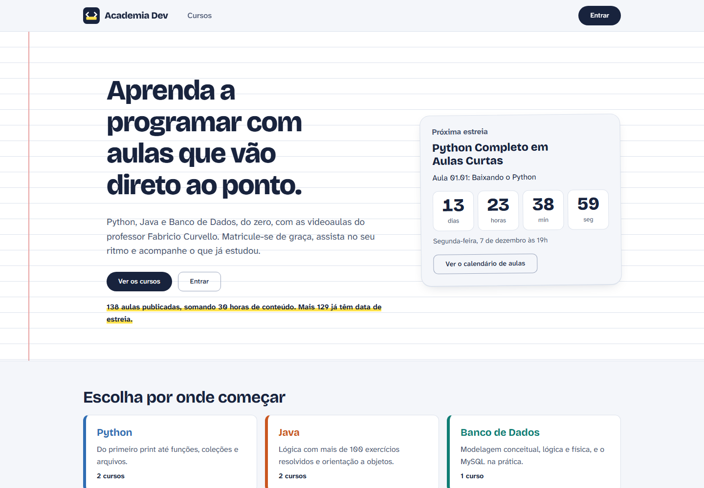
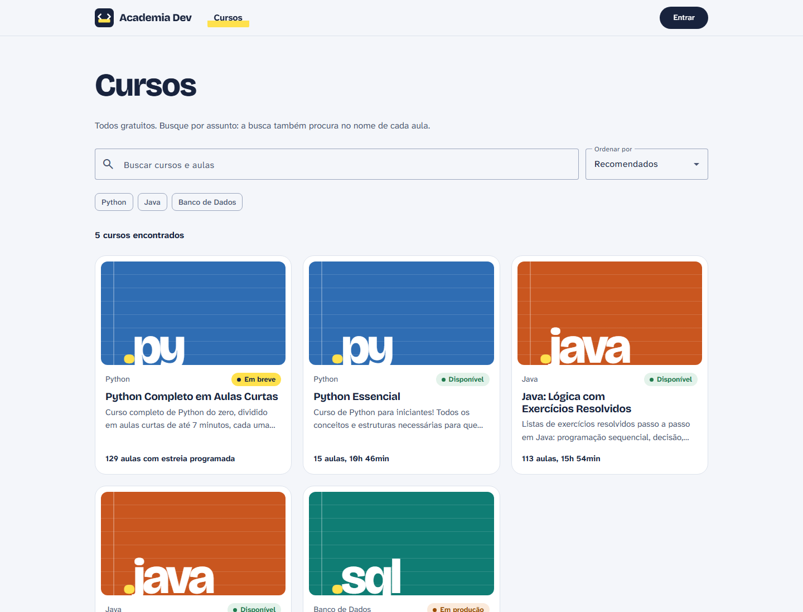
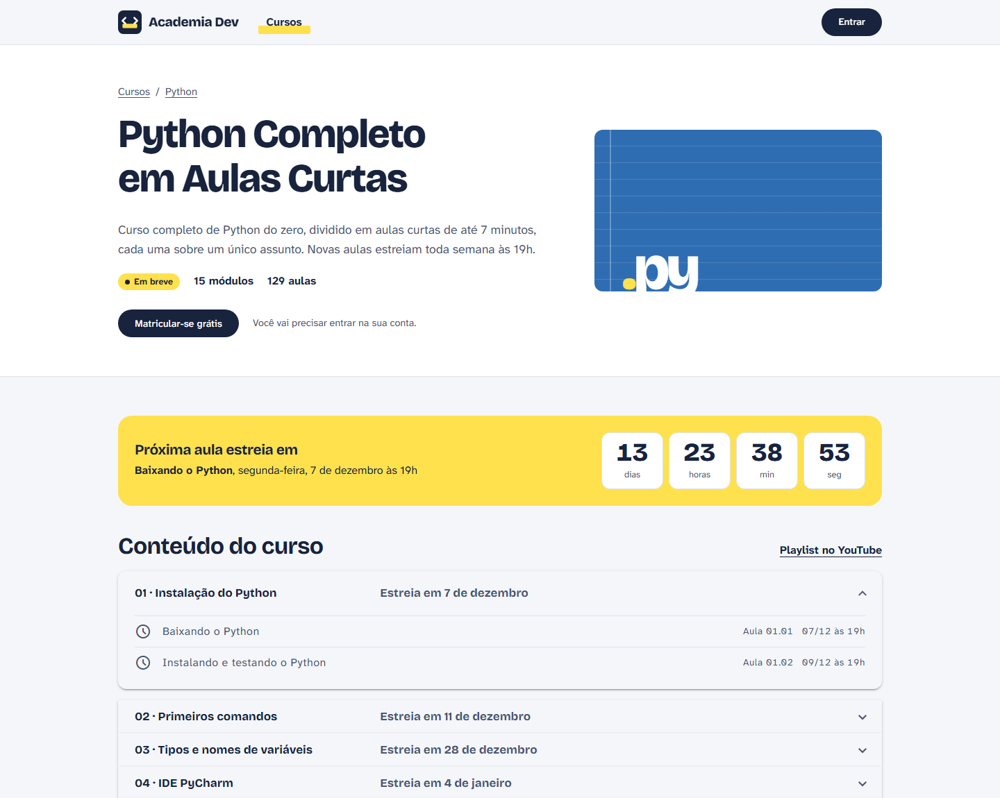
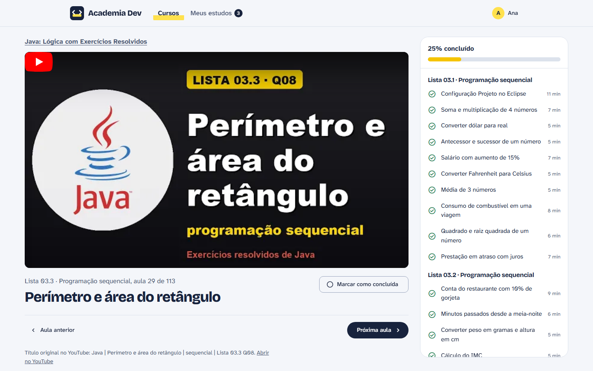
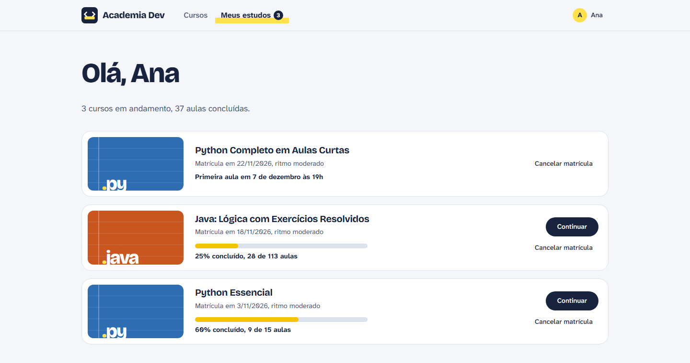
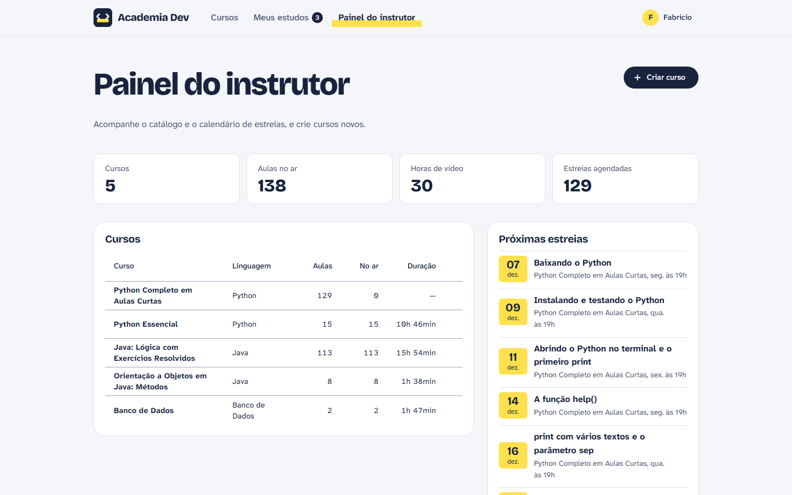
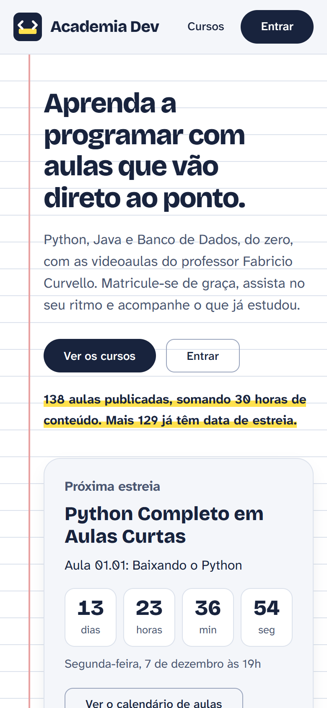
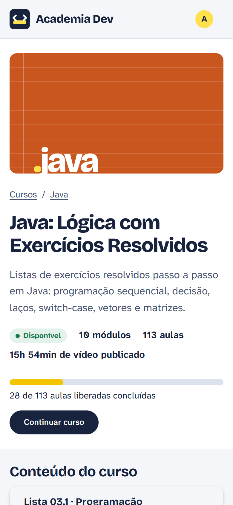
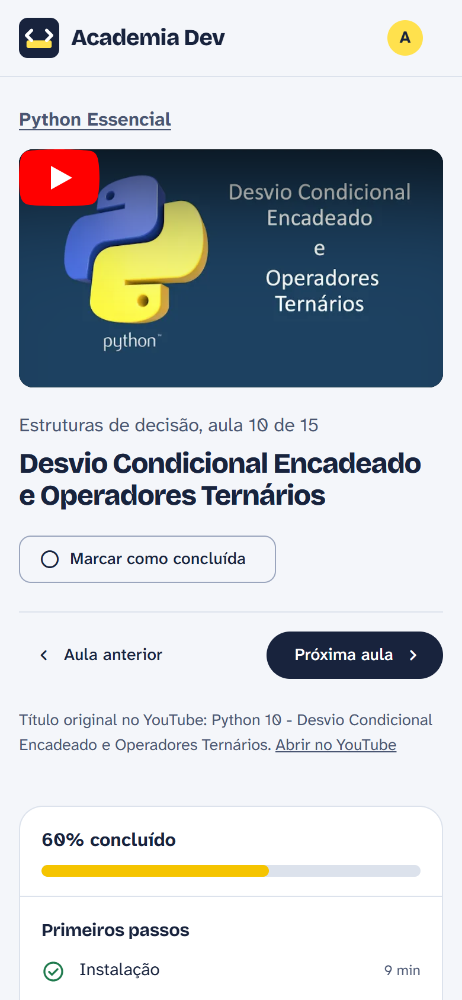
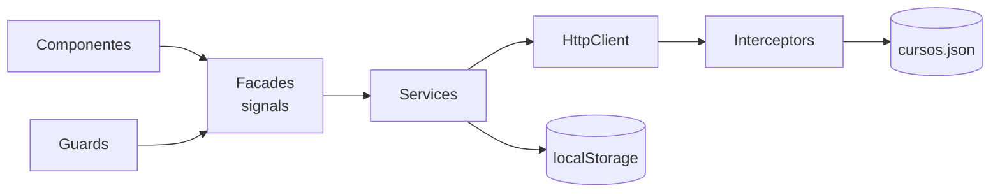

<div align="center">


# Academia Dev

**Aprenda a programar com aulas que vão direto ao ponto.**

Uma plataforma de cursos em Angular que transforma as videoaulas gratuitas do canal
[Fabricio Curvello](https://www.youtube.com/@fabriciocurvello) em cursos de verdade:
com matrícula, player integrado, progresso salvo e calendário de estreias.


[Funcionalidades](#-funcionalidades) ·
[Telas](#-telas) ·
[Angular na prática](#-angular-na-prática) ·
[Como rodar](#-como-rodar) ·
[Arquitetura](#-arquitetura)

<br />



</div>

<br />

## 📚 Os números do catálogo

Os dados são reais, extraídos das playlists públicas do canal:

| Curso | Linguagem | Módulos | Aulas | Situação |
|---|---|:---:|:---:|---|
| Python Completo em Aulas Curtas | Python | 15 | 129 | 🟡 Em breve: estreias toda semana a partir de 07/12/2026 |
| Python Essencial | Python | 5 | 15 | 🟢 Disponível |
| Java: Lógica com Exercícios Resolvidos | Java | 10 | 113 | 🟢 Disponível |
| Orientação a Objetos em Java: Métodos | Java | 1 | 8 | 🟢 Disponível |
| Banco de Dados | Banco de Dados | 1 | 2 | 🟠 Em produção |

São **138 aulas publicadas** (cerca de 30 horas de vídeo) e **129 aulas com estreia agendada**. O app libera cada
estreia sozinho quando a data chega: nada precisa ser republicado.

## ✨ Funcionalidades

**Para quem estuda**

- 🔎 **Catálogo com busca inteligente**: procura também no nome de cada aula ("fibonacci" encontra o curso de Java).
  Filtros e ordenação ficam na URL, então o link pode ser compartilhado.
- ⏳ **Contagem regressiva** para a próxima estreia e calendário de aulas dentro de cada curso.
- 📝 **Matrícula** com formulário validado: nome completo, e-mail, objetivo e ritmo de estudo.
- ▶️ **Player do YouTube integrado**: quando o vídeo termina, a aula é marcada como concluída e o app oferece a próxima.
- 📈 **Progresso salvo**: porcentagem por curso, botão "Continuar" que leva à próxima aula pendente e estreias que não
  contam contra o aluno.

**Para quem ensina**

- 📊 **Painel do instrutor** com os números do catálogo, tabela ordenável e as próximas estreias.
- 🧩 **Criação de cursos** com módulos e aulas dinâmicos, validação de links do YouTube, endereço (slug) gerado do
  título e checado de forma assíncrona, prévia ao vivo do card e aviso ao sair com alterações não salvas.

**Em todo o app**

- 📱 Layout responsivo do celular ao desktop.
- ♿ Navegação por teclado com foco visível, link "pular para o conteúdo", `aria-live` nos resultados e respeito a
  `prefers-reduced-motion`.
- ⚡ Renderização no servidor (SSR) nas páginas públicas e lazy loading em todas as rotas.

## 📸 Telas

<table>
  <tr>
    <td width="50%"></td>
    <td width="50%"></td>
  </tr>
  <tr>
    <td align="center"><b>Catálogo</b>: busca, filtro por linguagem e ordenação</td>
    <td align="center"><b>Curso em breve</b>: contagem regressiva e módulos com data de estreia</td>
  </tr>
  <tr>
    <td></td>
    <td></td>
  </tr>
  <tr>
    <td align="center"><b>Aula</b>: player, próxima aula e progresso do curso</td>
    <td align="center"><b>Meus estudos</b>: onde parei e quanto falta</td>
  </tr>
  <tr>
    <td colspan="2"></td>
  </tr>
  <tr>
    <td colspan="2" align="center"><b>Painel do instrutor</b>: catálogo, tabela ordenável e calendário de estreias</td>
  </tr>
</table>

<div align="center">
  
  &nbsp;
  
  &nbsp;
  
  <br />
  <sub>No celular</sub>
</div>

## 🧭 Angular na prática

Este projeto nasceu das minhas aulas de Angular (base: [meu-primeiro-app](https://github.com/fabcurvello/meu-primeiro-app))
e mostra cada conteúdo aplicado em uma funcionalidade real.

| Conteúdo | Como aparece no app | Onde está |
|---|---|---|
| Componentes standalone, `input()`, `@if` / `@for` / `@switch` / `@let` | Cards, capas geradas em CSS, selos de situação | `shared/components` |
| **Signals**: `signal`, `computed`, `effect` | Estado global, aulas liberadas recalculadas a cada segundo | `core/facades`, `core/services/relogio.service.ts` |
| `linkedSignal` | Matrículas recarregadas sozinhas no login e no logout | `core/facades/matriculas.facade.ts` |
| `toSignal` | Formulário alimentando a prévia ao vivo do card | `features/instrutor/novo-curso` |
| Padrão **Facade** | Componentes conversam só com `AuthFacade`, `CursosFacade` e `MatriculasFacade` | `core/facades` |
| **Rotas**: lazy loading, rotas filhas, `withComponentInputBinding` | Parâmetros e query params chegam como `input()` | `app.routes.ts` |
| **Guards funcionais** (`CanActivate`, `CanDeactivate`) | Login, perfil de instrutor, matrícula obrigatória, alterações não salvas | `core/guards/guards.ts` |
| **HttpClient** + **interceptors funcionais** | Token Bearer e mensagens amigáveis para 401, 403, 404 e 500 | `core/interceptors` |
| **Reactive Forms** tipados, `FormArray` aninhado | Matrícula e criação de curso com módulos e aulas | `features/matricula`, `features/instrutor/novo-curso` |
| Validadores próprios e **assíncrono** | Nome completo, link do YouTube, duração, slug único | `shared/validators` |
| **Pipes** próprios e `DatePipe` em pt-BR | `duracao` ("1h 37min") e `tituloAula` (limpa títulos do YouTube) | `shared/pipes` |
| **Diretiva** de atributo | `appImagemReserva` para imagens que falham | `shared/directives` |
| **SSR** + hidratação com `withEventReplay` | `RenderMode.Server` nas páginas públicas, `Client` nas áreas logadas | `app.routes.server.ts` |
| Código seguro para SSR | `isPlatformBrowser`, `afterNextRender`, `localStorage` protegido | `core/services/armazenamento.service.ts` |
| SEO com `Title` e `Meta` | Título e descrição por curso | `features/curso` |
| **Angular Material 3** com tema próprio | `mat.theme` + `theme-overrides`, tabela com `MatSort`, acordeão, chips | `src/styles.scss` |
| `@angular/youtube-player` | Player com evento de fim de vídeo | `features/aula` |
| Testes com **Vitest** | Pipes, utilitários de tempo, facades e o componente raiz | `*.spec.ts` |

## 🚀 Como rodar

Requisito: [Node.js](https://nodejs.org) 22 ou mais recente.

```bash
git clone https://github.com/fabcurvello/academia-dev.git
cd academia-dev
npm install
npm start
```

Abra **http://localhost:4200**.

| Comando | O que faz |
|---|---|
| `npm start` | Servidor de desenvolvimento |
| `npm test` | Testes unitários (Vitest) |
| `npm run build` | Build de produção com SSR |
| `npm run serve:ssr:academia-dev` | Sobe o servidor Express com o build de produção (porta 4000) |

### 🔑 Contas de demonstração

O login é simulado e não há backend. A tela de login tem atalhos para as duas contas:

| Perfil | E-mail | Senha |
|---|---|---|
| 🎓 Aluno | `aluno@academia.dev` | `aluno123` |
| 🧑‍🏫 Instrutor | `instrutor@academia.dev` | `instrutor123` |

Matrículas, progresso e cursos criados ficam no `localStorage` do navegador.

## 🧱 Arquitetura

```
src/app
├── core/                  regras e estado
│   ├── facades/           auth, cursos e matrículas (signals)
│   ├── guards/            authGuard, instrutorGuard, matriculaGuard, alteracoesPendentesGuard
│   ├── interceptors/      token e tratamento de erros
│   ├── models/            Curso, Modulo, Aula, Usuario, Matricula
│   ├── services/          dados, localStorage e relógio
│   └── utils/             cálculo de durações, estreias e IDs do YouTube
├── features/              uma pasta por página, todas com lazy loading
│   ├── inicio/  catalogo/  curso/  matricula/  aula/
│   ├── login/  minha-area/  instrutor/  erros/
└── shared/                componentes, layout, pipes, diretiva e validadores
public/data/cursos.json    catálogo com os IDs, títulos e durações dos vídeos
```



## 🎨 Design

A identidade visual parte da ideia de um **caderno de estudos**: papel com pauta e linha de margem na abertura, tinta
azul-escura e **amarelo de marca-texto** para o que importa (progresso, item ativo, estreias). Cada linguagem tem sua
cor, e as capas dos cursos são geradas em CSS com a extensão do arquivo (`.py`, `.java`, `.sql`).

Tipografia: **Bricolage Grotesque** nos títulos e **Atkinson Hyperlegible Next** no texto, uma fonte criada para
máxima legibilidade.

## 👨‍🏫 Autor

**Fabricio Curvello**, desenvolvedor e professor de desenvolvimento de software nas Faculdades IBMR e no Senai.

[](https://www.youtube.com/@fabriciocurvello)
[](https://www.linkedin.com/in/fabriciocurvello)
[](https://github.com/fabcurvello)

<sub>As videoaulas pertencem ao canal Fabricio Curvello e são exibidas pelo player oficial do YouTube.</sub>
